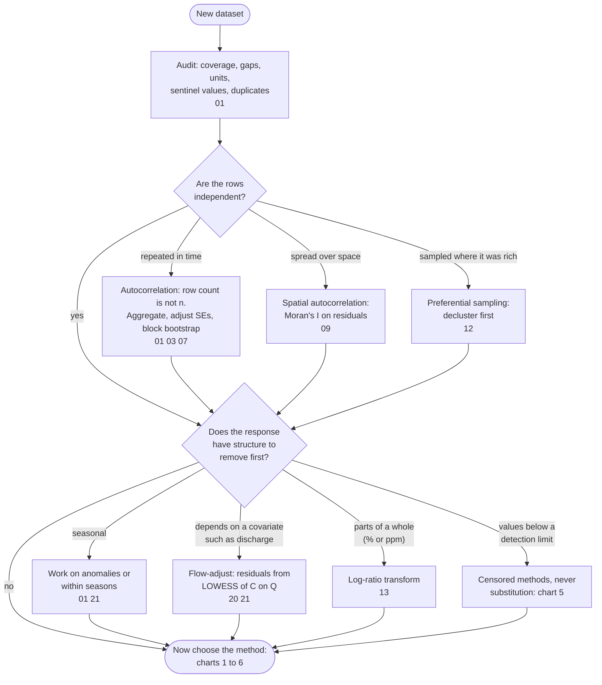
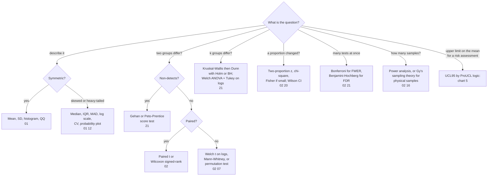
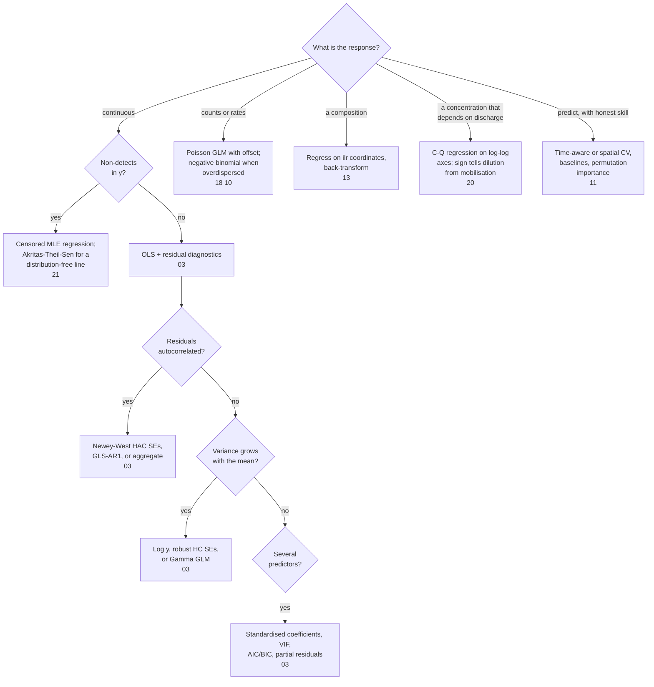
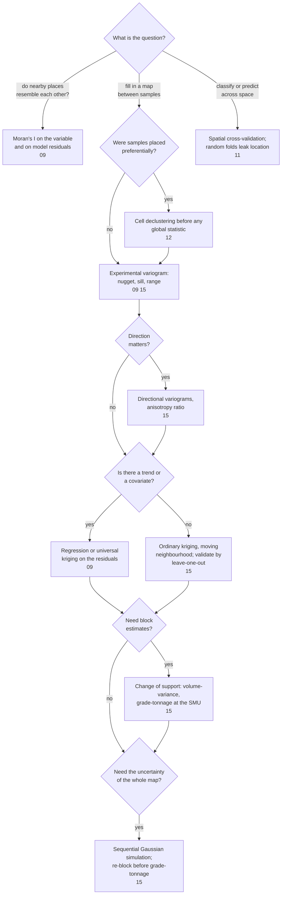
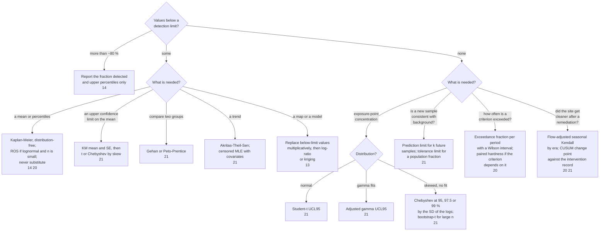
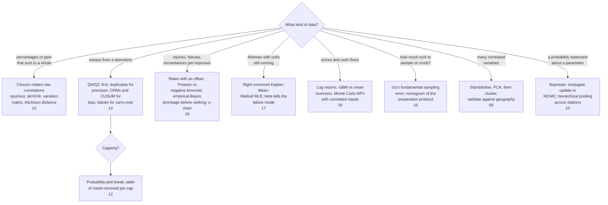

# Choosing a statistical method for earth-science and mining data

A decision chart from the question and the shape of the data to a method, and from the
method to a runnable worked example in [CHEATSHEET.md](CHEATSHEET.md). It starts from the
earth-science question rather than from the statistics, because that first layer (is the
response censored, seasonal, autocorrelated, spatial, compositional, preferentially sampled?)
is where generic "which test" charts stop and where environmental data usually break the
assumptions.

Codes in the boxes are section numbers: **01-11** are the general methods worked on
environmental data and **12-21** the methods specific to mining practice. The index at the end
links each code to its script in [`analyses/`](analyses).

The charts are original and drawn in [Mermaid](https://mermaid.js.org), so they render on
GitHub and can be edited as text. The decision logic condenses the sources listed at the
end; the USGS and EPA documents among them are works of the United States government and in
the public domain.

## 0. Before any method

## 1. One variable, or a few groups

## 2. Relationships and regression

## 3. Time series, trends and extremes

```mermaid
flowchart TD
    A{What is the question?} -- "is there a<br>monotonic trend?" --> B{Seasonal<br>sampling?}
    B -- "monthly or seasonal" --> B1[Seasonal Kendall + Sen slope,<br>flow-adjusted if C depends on Q<br>21 20]
    B -- "annual series" --> B2[Mann-Kendall with Hamed-Rao<br>correction, Sen slope;<br>OLS with HAC SEs<br>05]
    B1 --> B3{Non-detects?}
    B3 -- yes --> B4[Akritas-Theil-Sen or<br>censored MLE with time<br>21]
    A -- "when did it change?" --> C[Pettitt for a shift, hinge<br>regression for a slope change,<br>CUSUM, PELT for many<br>05 20]
    A -- "forecast it" --> D[STL, ADF/KPSS, SARIMA or<br>Holt-Winters; time-ordered<br>holdout against naive baselines<br>04]
    A -- "hidden periodicity?" --> E[Periodogram after detrending;<br>test against red noise<br>04]
    A -- "does x lead y?" --> F[Cross-correlation of detrended<br>or pre-whitened series<br>04]
    A -- "how big is the<br>100-year event?" --> G{Block maxima or<br>peaks over threshold?}
    G -- "annual maxima" --> G1[GEV; bootstrap the<br>return level<br>06]
    G -- "all exceedances" --> G2[GPD after declustering<br>06]
    G1 --> G3{Climate or land use<br>changing?}
    G2 --> G3
    G3 -- yes --> G4[Nonstationary GEV,<br>likelihood-ratio test<br>06]
    A -- "has a process or KPI<br>shifted?" --> H[Shewhart I-MR for big shifts;<br>CUSUM or EWMA for small<br>sustained ones<br>17 14]
    A -- "uncertainty on any<br>of these?" --> I[Block bootstrap, Monte Carlo<br>from a fitted AR1 null<br>07]
```

## 4. Spatial data

## 5. Censored values and compliance limits

## 6. Compositions, counts, lifetimes, money and samples

## Script index

| Code | Script |
|---|---|
| 01 | [EDA and climatology](analyses/01_eda.py) |
| 02 | [Hypothesis tests, power, multiplicity](analyses/02_hypothesis_tests.py) |
| 03 | [Regression and diagnostics](analyses/03_regression.py) |
| 04 | [Time series and spectra](analyses/04_time_series.py) |
| 05 | [Trends and change points](analyses/05_trends_changepoints.py) |
| 06 | [Extremes](analyses/06_extremes.py) |
| 07 | [Resampling](analyses/07_resampling.py) |
| 08 | [Multivariate](analyses/08_multivariate.py) |
| 09 | [Spatial statistics](analyses/09_spatial.py) |
| 10 | [Bayesian](analyses/10_bayesian.py) |
| 11 | [Machine learning](analyses/11_ml.py) |
| 12 | [Assay EDA, declustering, capping](analyses/12_assay_eda.py) |
| 13 | [Compositional data](analyses/13_compositional.py) |
| 14 | [QA/QC and non-detects](analyses/14_qaqc.py) |
| 15 | [Geostatistics](analyses/15_geostatistics.py) |
| 16 | [Sampling theory](analyses/16_sampling_theory.py) |
| 17 | [Reliability and SPC](analyses/17_reliability.py) |
| 18 | [Safety rates](analyses/18_safety.py) |
| 19 | [Economics](analyses/19_economics.py) |
| 20 | [Environmental monitoring](analyses/20_environmental.py) |
| 21 | [Censored inference, seasonal trends, compliance limits](analyses/21_censored_inference.py) |

## Sources the logic condenses

- Helsel, D.R., Hirsch, R.M., Ryberg, K.R., Archfield, S.A. and Gilroy, E.J. (2020). *Statistical
  Methods in Water Resources*. USGS Techniques and Methods 4-A3. https://doi.org/10.3133/tm4A3.
  Public domain. The backbone of charts 1 to 3 and 5.
- Helsel, D.R. (2012). *Statistics for Censored Environmental Data Using Minitab and R*, 2nd ed.
  Wiley. Kaplan-Meier, ROS, Gehan and Peto-Prentice, Akritas-Theil-Sen, censored MLE.
- Hirsch, R.M., Slack, J.R. and Smith, R.A. (1982). Techniques of trend analysis for monthly
  water quality data. *Water Resources Research* 18(1), 107-121. The seasonal Kendall test.
- Hirsch, R.M., Moyer, D.L. and Archfield, S.A. (2010). Weighted regressions on time, discharge,
  and season (WRTDS). *JAWRA* 46(5), 857-880.
- U.S. EPA (2022). *ProUCL Version 5.2 Technical Guide*. Office of Research and Development.
  Public domain. The UCL decision tables in chart 5.
- U.S. EPA (2009). *Statistical Analysis of Groundwater Monitoring Data at RCRA Facilities:
  Unified Guidance*, EPA 530/R-09-007. Public domain. Prediction and tolerance limits.
- Isaaks, E.H. and Srivastava, R.M. (1989). *An Introduction to Applied Geostatistics*. Oxford.
  Rossi, M.E. and Deutsch, C.V. (2014). *Mineral Resource Estimation*. Springer. Chart 4.
- Aitchison, J. (1986). *The Statistical Analysis of Compositional Data*. Chapman and Hall.
  Pawlowsky-Glahn, V., Egozcue, J.J. and Tolosana-Delgado, R. (2015). *Modeling and Analysis
  of Compositional Data*. Wiley. Chart 6.
- Coles, S. (2001). *An Introduction to Statistical Modeling of Extreme Values*. Springer.
- Gy, P. (1979). *Sampling of Particulate Materials*. Elsevier. Chart 6.
- Generic "which statistical test" decision trees published by university statistics services
  (for example the University of Manchester and Loughborough University charts) cover the
  two-group and k-group branches of chart 1. They are copyrighted and are not reproduced here.
